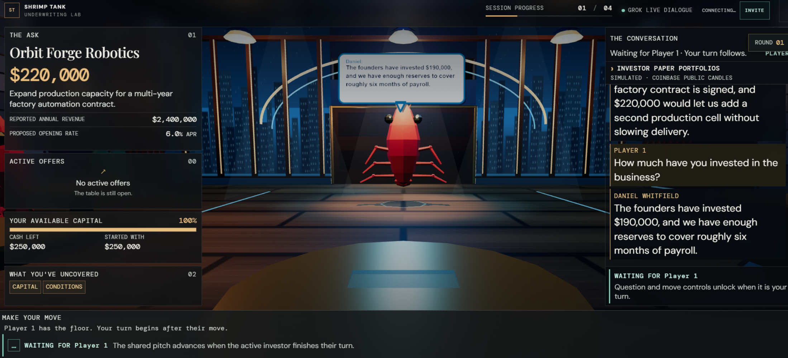

# Shrimp Tank

Devpost link: https://devpost.com/software/shrimp-tank



Shrimp Tank is a fictional B2B loan negotiation game. Players join a shared pitch as separate investor seats, question the founder, review the other investors' discussion, and decide whether to offer a loan, pass, or leave the pitch. A five Cs rubric explains the rules-based outcome. The game is educational and does not make real credit decisions.

The project has three parts:

- A Vite, TypeScript, and Three.js browser game with a procedural low-poly shrimp studio.
- A FastAPI service that owns session rules, Grok dialogue, underwriting, and the investor paper-portfolio simulator using Coinbase's public market data.
- A SpacetimeDB TypeScript module that stores session snapshots and ordered conversation messages.

Devices on a trusted local network can join the same game through an invite link as separate investor players. They share the founder pitch, AI investors, offers, and conversation, while each player has an independent balance, out state, turn, and scorecard. Players act in sequence: each may ask one question and then submit an offer, pass, or leave before the turn advances. The first seat to act rotates between pitches. A player joining mid-session is scored only on pitches where they take an action. FastAPI WebSockets provide in-process live state updates, while SpacetimeDB persists the complete session snapshot. Seat association uses a browser session-storage ID without authentication; this is a trusted-LAN preview, not an account or access-control system. Do not expose it to the public internet. The score reflects a fixed teaching rubric, not demonstrated underwriting skill or a calibrated repayment prediction.

## What the game does

- Starts with a skippable presenter entrance: backstage doors, a widened hallway, outward-opening wooden stage doors, and a final investor-seat camera shot. A reduced-motion preference skips the animation.
- Places the player at the center of a semicircle of investor shrimps. The studio, floor, windows, stage lighting, and low-poly characters are generated in Three.js; no external shrimp model is required.
- Lets a player choose one to four pitches and a starting-capital difficulty.
- Grounds fictional founder scenarios in synthetic CRS persona facts and locally authored business profiles. The game does not pull credit reports at runtime.
- Gives Kevin, Lori, and Mark separate paper portfolios that persist across pitches within a game session and reset for a new game. A small rule-based trading agent reads public Coinbase candle data once per pitch, records at most one simulated rebalance for each investor, and offers Grok qualitative investor-side context.
- Uses one Grok request to produce a structured, fact-constrained turn for the founder and two investors. A separate request writes the founder's counters. It does not make one model call per investor.
- Keeps underwriting and deal selection deterministic in the backend; Grok supplies dialogue, not credit decisions.
- Leaves each pitch open with no fixed round cap. The founder counters each pending shark offer by name, and counters a player's offer using that seat's name. A countered shark answers from a fixed personality rule: usually holding the bid, and sometimes trimming it once. Three rounds with no offer at all, and the founder walks away. Once an offer exists, one additional round is played, and only then does a round with no newer offer close the pitch. The founder accepts a qualifying offer or walks away.
- Preserves the whole conversation through the offer decision, then asks the player to reveal the founder's selection before moving on.
- Includes a debug reset control that deletes the active session and returns to setup, plus live status announcements and reduced-motion support.

## Technologies Used

### xAI Grok API

Grok gives the investors distinct, configured personalities. Kevin O'Leary's game profile focuses on return, pricing, and downside protection; Lori Greiner's on product clarity, customer demand, and execution; Mark Cuban's on operating leverage, customer concentration, and scale. These are fictionalized game personas, not replicas or endorsements.

The founder also uses Grok: first-person instructions ask for a direct, conversational answer without reading out sandbox/report jargon. A player question supplies all five case disclosure facts plus public pitch details so Grok can answer by meaning; the keyword-selected fact is only a hint. Investor follow-up answers remain limited to their assigned fact, and founder answers stay within 30 words. The backend sends one structured request per player question. That request produces the founder's answers and a short exchange between two investors, using the selected sharks' profile instructions. Investor lines are checked for length and numbers; the question line must end with a question mark. This keeps the voices distinct while avoiding a separate request and extra latency for every shark. Grok does not decide creditworthiness or whether a deal is accepted; deterministic Python rules handle those outcomes. The API key stays on the backend.

Detailed personality prompts live in `SHARKS[].ai_profile.system_prompt` in `backend/app/catalog.py`. `backend/app/agents.py` combines the two selected personalities with shared instructions in the actual system message for question and offer/pass/exit exchanges. Kevin emphasizes repayment and downside, Lori customer demand and fulfillment, and Mark execution and operating bottlenecks. The [personality guide](docs/shark-personalities.md) links the public research, explains the design interpretation, and describes the retained short-line rules and offline request checks.

**Challenges encountered:** Separate calls for each shark made the first question feel slow and made the table seem to be waiting on several independent agents. The implementation now asks Grok once for the complete four-line exchange. Another mismatch was that the browser showed “responding” status labels while the conversation text did not appear until later. The client now re-renders the saved exchange as soon as the stream completes and plays it in sync with the speech bubbles. During Grok generation, it still shows progress labels rather than partial dialogue; timed playback starts after the full response is validated and saved. Multiplayer originally synchronized multiple clients to the same controls and balance. The LAN preview now assigns each joining browser a player seat, rotates turns after each move, and returns each client its own balance and scorecard while keeping the negotiation shared.

### SpacetimeDB

SpacetimeDB stores durable session snapshots and an indexed copy of the conversation. The `game_session` row holds the complete serialized game state; `conversation_message` holds one ordered row per message. Both are written in the same reducer transaction. The tables are private because the session snapshot contains hidden borrower profiles. A private `session_cleanup_schedule` table runs database-side cleanup every 20 minutes: sessions whose last saved update is more than two hours old are deleted together with all their conversation rows. The current FastAPI adapter restores the transcript from the session snapshot; it writes the message rows but does not query them. The browser receives question streams over FastAPI server-sent events and shared-session state snapshots over FastAPI WebSockets; it never connects to SpacetimeDB directly.

The field definitions, payload shape, indexes, reducer behavior, privacy choices, and rationale for each table are documented in [SpacetimeDB Data Model](docs/data-model.md).

Session expiration is based on the last successful save, not the game's creation time. Questions, passes, offers, reveals, and pitch advancement renew it; reads, camera movement, and leaving a page open do not. Both unfinished and completed games expire under this policy. The next scheduled sweep normally removes an idle game between two hours and two hours twenty minutes after its last save. Reset requests immediate deletion, while Exit, Back to Lobby, and Run It Back leave previous records for expiration. See [cleanup behavior and testing](docs/data-model.md#session-expiration-and-cleanup).

The founder-profile data path, five Cs rubric, benchmark, Decision Fit, and Underwriting Instinct formulas are documented in [Scorecard Logic](docs/scorecard-logic.md).

### Coinbase market data and investor paper portfolios

The portfolio agent in `backend/app/portfolio_agent.py` reads hourly BTC-USD, ETH-USD, and SOL-USD candles from Coinbase's unauthenticated [public Advanced Trade candles endpoint](https://docs.cdp.coinbase.com/api-reference/advanced-trade-api/rest-api/public/get-public-product-candles), using a shared 60-second in-process market-data cache. It calculates an approximate 24-hour momentum signal and a simple realized-volatility penalty, then applies three configured cash/reserve and risk-threshold policies. These are illustrative rules, not validated investment strategies or descriptions of the real investors' holdings. Each new game starts Kevin, Lori, and Mark with independent fictional $100,000 portfolios. The agent marks positions and considers at most one small paper rebalance per pitch; its rules and simulated trade history persist across that session's pitches in `GameSession.investor_portfolios`, inside the existing SpacetimeDB session snapshot. A new game starts fresh portfolios. No database table or migration is needed.

The browser shows the portfolio values, cash, holdings, market changes, and current signal in a collapsed **Investor Paper Portfolios** panel. During dialogue, the existing single Grok request receives short, qualitative summaries for the two investors in that exchange. Grok may use those summaries as optional investor risk-appetite context; they are explicitly marked as fictional paper trading and cannot be treated as founder facts or underwriting evidence. The trading rule itself is deterministic Python; it does not use a second AI call.

This uses Coinbase public market data directly. It does **not** connect the Coinbase for Agents MCP, Coinbase Wallet MCP, x402, a Coinbase account, or a wallet, and it never creates exchange orders. If any watched product quote is missing, the agent records a hold recommendation and the UI marks the feed as partial or unavailable. This is a bounded paper-trading feature, not the Coinbase MCP integration described in the hackathon prompt and not a loan-optimization benchmark.

For a focused, code-backed review of data origins, architecture, the five Cs, scoring, and gameplay, see [Methodology Questions and Answers](docs/methodology.md). Its retained questions are answered in place and distinguish inspected implementation, isolated offline checks, and evidence the repository does not establish. Detailed formulas and the current case inventory live in the scorecard guide.

**Challenges encountered:** Local FastAPI startup requires a SpacetimeDB token, supplied by `spacetime login` or `SPACETIMEDB_TOKEN`. The backend does not ping the database during startup, so a missing or unpublished database appears later as a failed persistence request. Deployed FastAPI needs the owner token as a server secret. The tables are private because the session row contains hidden profiles and unrevealed outcomes. A separate conversation table provides an indexed path for future transcript queries; the current adapter restores the transcript from the session snapshot and does not read the message rows. Multiplayer state sync is an application-level LAN preview: FastAPI remains the state owner, while its in-process WebSocket hub sends the public session projection to other connected browsers after a saved action. Separate seats and sequential turn checks are stored in the session snapshot, but identity is not authenticated and the hub will not coordinate multiple FastAPI workers.

### CRS CalHacks MCP server and CRS sandbox

The npm package [`@crscreditapi/crs-calhacks-mcp-server`](https://www.npmjs.com/package/@crscreditapi/crs-calhacks-mcp-server) is used during development as a reference and discovery tool. We use tools such as `get_personas` and `get_product_guide` to inspect synthetic applicants and product details; `get_api_schema` and `get_test_data` help check product fields and canned cases. That information informed the local synthetic persona catalog.

The deployed game does **not** call the MCP server or CRS APIs at runtime. MCP is the developer/agent interface; the FastAPI app has no MCP client dependency. CRS persona information was used to construct the bundled fictional founder profiles, so gameplay does not require CRS credentials and does not make credit-report requests.

CRS is the external credit-data source, exposed through product APIs and MCP resources; this does not establish access to CRS's internal database tables or identify its database engine. SpacetimeDB separately stores the game's sessions and conversation records.

The profile path is:

1. MCP persona information provides synthetic examples that inform the founder credit profiles.
2. `backend/app/catalog.py` associates 19 playable persona IDs and synthetic founder identities with authored businesses, requests, revenue, repayment capacity, owner equity, collateral, and market conditions. P14 is not a playable case. These are fixed entries, not new financial profiles generated each time a presenter appears.
3. Bundled credit facts and business metrics provide the evidence used by Grok dialogue and the deterministic underwriting model. The data-model guide lists [field origins and CRS-backed facts for every persona](docs/data-model.md#founder-field-origins). By project convention, borrower/scenario inputs without a directly available CRS source are labeled **AI synthesized**, including fixed financial inputs and local credit proxies. The guide traces those inputs into the risk score; this classification does not mean Grok generates the profile during gameplay.

CRS supplies synthetic persona examples for the bundled catalog; the fictional business and five Cs teaching profile are curated locally. In `backend/app/catalog.py`, `PROFILES` starts empty and all 19 playable cases pass through `_crs_presenter`; a session randomly selects 1–4 cases from that full list without replacement. P14, the deceased-file case, is excluded. Original report bodies, request IDs, bureau-model metadata, and a field-level import history are not retained in the repository, so the bundled values are not independently reconciled to source reports at runtime. No real applicant data is used.

**Challenges encountered:** The MCP guide covers several CRS products, and the initial design added an optional direct sandbox-report pull during a pitch. That feature required credentials and could update the credit score mid-game, adding a second source of state for the underwriting decision. To keep the game simpler, the report panel, runtime connector, endpoint, and credential settings have been removed. CRS persona examples remain bundled as synthetic scenario facts; Grok phrases those supplied facts conversationally, and the backend rejects founder answers with numbers absent from the selected fact. That check does not prove every non-numeric claim is supported, so the prompt remains an important safeguard.

### TypeScript, Vite, and Three.js

TypeScript and Vite build the browser client; Three.js creates the shrimp actors and studio from code-generated geometry, materials, and lights.

**Challenges encountered:** The stage has appeared as a mostly empty color panel during layout changes, and some camera/UI arrangements obscured the environment or the speech bubbles. The current camera supports limited dragging and speaker-following rather than a permanently locked view. Door frames briefly looked like bars across the presenter's route; a thin cyan horizon line in the city-window texture can still be mistaken for one. An external shrimp model was tried and then reverted, so the characters remain procedural. Long dialogue also obscured the set: the transcript keeps the full current-pitch text, while each 3D bubble shows the last four wrapped lines as text arrives. On desktop, the scrolling conversation is in the right rail, the summary panels are on the left, and the decision dock stays below. Reduced-motion, focus styles, labels, and live announcements exist; no completed accessibility audit is claimed.

### Python, FastAPI, Pydantic, HTTPX, and Render

FastAPI owns session transitions and underwriting. HTTPX calls Grok from the server; the SpacetimeDB adapter persists game state. Render hosts the API and static frontend; `scripts/deploy-render.sh` publishes the SpacetimeDB module and triggers the existing Render services.

FastAPI uses Pydantic for input validation. The request models in [`backend/app/main.py`](backend/app/main.py) define accepted fields, types, defaults, and limits for starting sessions, asking questions, and submitting decisions. Examples include 1–4 pitches per session, questions between 2 and 400 characters, and loan terms between 6 and 84 months. Invalid inputs receive an HTTP 422 validation response. The models allow Pydantic's default type conversions and ignore unknown fields; they are not configured for strict typing. Amount and rate are optional in the request model and required separately by the offer handler. Backend handlers also enforce phase, balance, and offer-eligibility rules. Passing these checks does not establish that a real loan is sound.

The SpacetimeDB adapter currently makes synchronous HTTPX calls directly from async routes. Those database requests can block a worker's event loop and delay other requests or dialogue streams. Session locks are local to one process; the database's version check rejects stale saves across processes but does not serialize the preceding Grok generation. See [SpacetimeDB operational limits](docs/data-model.md#operational-limits).

**Challenges encountered:** The root `.env` is intentionally ignored and is not present in a fresh clone, while Uvicorn resolves `--env-file` paths from the current directory. That caused the missing `../.env` startup error when setup was incomplete or run from the wrong folder. “Can't reach the game server” also occurred when Vite was running on port 5173 but FastAPI was not running on port 8000. Render also needs an exact `FRONTEND_ORIGINS` CORS value and `VITE_API_BASE` at frontend build time. A game-state bug made **I'm Out** end the session; the backend now records the player as out while allowing the other investors to finish the pitch and the player to review its result. The setup instructions below configure both processes, credentials, and the SpacetimeDB connection.

## Run locally

Requirements: Python 3.11+, Node.js 20.19+ or 22.12+, npm, the [SpacetimeDB CLI](https://spacetimedb.com/docs/), and an xAI API key for live Grok dialogue. The app defaults to persistent SpacetimeDB state. Live Grok is required for personality-based dialogue; without the key, the app falls back to its scripted offline mode.

1. Create a virtual environment and install the API dependencies:

   ```bash
   python3 -m venv .venv
   source .venv/bin/activate
   pip install -r backend/requirements.txt
   ```

2. Create the ignored root environment file from the template if you do not already have one:

   ```bash
   cp .env.example .env
   ```

   Edit `.env` and set at least:

   ```dotenv
   GROK_API_KEY=your-xai-api-key
   SESSION_STORE=spacetime
   SPACETIMEDB_URI=https://maincloud.spacetimedb.com
   SPACETIMEDB_DATABASE=credit-tank-state
   SPACETIMEDB_TOKEN=
   ```

   `GROK_API_KEY` is required for live shark personalities. Keep it in the ignored root `.env`; never put it in a frontend `VITE_*` variable. For local SpacetimeDB use, the token can stay blank because the backend reads the CLI login token. CRS credentials are not required; the game uses bundled synthetic persona facts.

3. Confirm that SpacetimeDB is available and the configured database exists:

   ```bash
   spacetime login
   spacetime server ping maincloud
   spacetime list
   ```

   See the current [SpacetimeDB CLI reference](https://spacetimedb.com/docs/cli-reference/) for installation and command options.

   Confirm `credit-tank-state` is listed on `maincloud` and has the module from `spacetime/spacetimedb`. If this is a first-time setup and the database has not been published, run this from the repository root:

   ```bash
   spacetime publish credit-tank-state \
     --module-path ./spacetime/spacetimedb \
     --server maincloud \
     --no-config \
     --yes
   ```

   New databases install the cleanup schedule automatically. After upgrading an existing database, run the following once to enable the schedule and immediately remove expired sessions. It is safe to rerun:

   ```bash
   spacetime call credit-tank-state cleanup_expired_sessions \
     --server maincloud --no-config --yes
   ```

   Use the same database name and server in `.env`. Do not publish to a different database and expect the existing sessions to appear there. If you do not have SpacetimeDB access and only need a temporary local run, set `SESSION_STORE=memory`; state then disappears when FastAPI restarts.

4. Start FastAPI in one terminal. The `--env-file` path is relative to the current working directory, so run this from `backend/`:

   ```bash
   cd backend
   uvicorn app.main:app --reload --env-file ../.env
   ```

   The API is at `http://localhost:8000`; interactive API documentation is at `http://localhost:8000/docs`.

   Verify the selected modes at `http://localhost:8000/api/config`. `ai_provider` should be `xai` and `database` should be `spacetimedb` when their environment settings are present. This endpoint reports configuration selection; it does not verify that Grok credentials or the SpacetimeDB database are reachable.

5. Start the browser app in a second terminal:

   ```bash
   cd frontend
   npm ci
   npm run dev
   ```

   Open the Vite URL, usually `http://localhost:5173`. Unless overridden, the frontend connects to port 8000 on the same hostname used to open the page. To use a different API, copy `frontend/.env.example` to an ignored local env file such as `frontend/.env.local` and set `VITE_API_BASE`.

### Troubleshooting

- **`--env-file ../.env` does not exist:** this happens when the root `.env` has not been created, or when Uvicorn is launched from the wrong directory. Copy `.env.example` to the project root and run Uvicorn from `backend/` using the command above.
- **“Can't reach the game server” or a guest cannot join:** Vite on port 5173 serves the page; FastAPI on port 8000 serves game requests and the live WebSocket. For another device, check that both services bind to the LAN, `VITE_API_BASE` uses the host's LAN IP, `FRONTEND_ORIGINS` matches the browser origin exactly, and the firewall allows the ports.
- **The browser shows offline dialogue:** `/api/config` reports `ai_provider: "offline"` when `GROK_API_KEY` is missing. Add the key to the root `.env` and restart FastAPI. The key is server-only; never put it in a `VITE_*` variable.
- **SpacetimeDB token or database errors:** if FastAPI exits during startup, run `spacetime login` or set `SPACETIMEDB_TOKEN`. If the API starts but session requests fail, confirm that the configured database and module exist on the configured server. On Render, set `SPACETIMEDB_TOKEN` in the service's secret environment settings.

## Dialogue and turn flow

### Question routing and investor behavior

Free-text questions use a case-insensitive substring keyword counter to select a five-Cs hint and a coverage label. Ties use topic-name ordering. In live Grok mode, this hint no longer restricts the founder to one sentence: the request includes all five case disclosures and public pitch details so the founder can answer the actual question by meaning, including mixed-topic wording. The offline path still returns the selected fact or a fixed unavailable-information response. The investor follow-up topic cycles through conditions, capacity, and collateral. Coverage chips still record keyword-routed/discussed topics; they are not a semantic audit of everything the founder said and do not affect the score.

Each Grok request writes multiple fictional voices. It receives public business context, the current question where applicable, supplied facts, persona instructions, and at most eight spoken entries selected from the last twelve messages. Human questions, offers, counters, and investor replies are included; stage-manager round events are excluded. The full numeric profile and calculated grade are not sent. Investor sentiment does not determine the opening bid; fixed backend rules select the bidder and terms from the full assessment. A catalog personality rule can then revise that shark's own pending bid once.

### Grok and response length

The live provider is xAI Grok through the streaming Chat Completions API (`/v1/chat/completions`, `stream: true`). Claude is not used. The key is read by FastAPI from `GROK_API_KEY`. The default model is `grok-4.3` with reasoning disabled; model, reasoning effort, API base URL, and timeout can be set with the `GROK_*` variables in `.env.example`.

One question request generates four short, structured lines: the founder answers the player, one investor asks a focused follow-up, the founder answers using its assigned fact, and a second investor reacts. Pass and exit exchanges request three lines: investor question, founder answer, and investor reaction. A nonmatching offer adds a named founder response before those lines within the same request. A new offer matching the displayed request closes immediately with a system-authored founder acceptance and makes no Grok request. Founder answers stay within 30 words and offer responses within 40; investor questions/reactions have 4–18 words and cannot introduce numbers. For player answers, numeric checks use all supplied disclosure/public-pitch facts; assigned investor answers remain restricted to their assigned fact. These checks do not semantically verify every non-numeric claim. Counter validation removes the exact addressed seat name before checking financial numbers, so a legitimate name such as Player 1 does not force a canned fallback. Replies cannot announce a final deal, and matching funding/pricing is acknowledged rather than automatically countered. Without a key the game uses its explicitly labeled offline fallback.

The request uses strict JSON Schema for the expected string fields and requests character limits; Python separately checks field names, types, word counts, numeric tokens, and the question's final `?`. It does not separately recheck character limits or the instruction that reactions contain one sentence. Dialogue requests set `max_tokens: 420`. A separate founder-counter request, sent when other pending offers need a response, sets `max_tokens: 800` and requires each line to name the investor being countered. The shark's answer is a scripted line from that investor's personality rule and does not add another model request. An HTTP 5xx response is retried automatically, waiting 15 seconds and then doubling that wait up to 120 seconds, until Grok responds. A complete offer/pass/exit table exchange that fails the dialogue checks is regenerated up to two more times with clearer format instructions; if all three attempts fail, the move returns an error and leaves the turn unchanged. Player-question validation and other HTTP errors are not retried by that mechanism. There is no aggregate token or dollar budget, or per-user rate limiter. A failed turn can be submitted again without advancing the round. After the latest new offer, one more round is played, but a player who submits a new offer every round resets that clock, so the quiet-offer rule does not by itself cap total API spend. Three rounds with no offer at all also end the pitch.

### What players see while a question is answered

The question is added to the transcript immediately. While the API builds and validates the complete exchange, the browser receives server-sent progress and text-delta events. The current UI shows speaker/progress labels during that generation step; it does not yet paint the streamed Grok text deltas into the transcript. Once the API sends the saved session, the browser renders those canonical messages and plays them in order in the transcript and the 3D speech bubbles.

Each incoming line takes four seconds to reveal, followed by a two-second pause before the next line. The transcript follows the active line and retains the complete text; a 3D bubble appears above the current speaker. Reduced-motion mode displays the full transcript without timed playback. There is no standalone **Show All** control: during normal playback, offer, pass, and exit are disabled until the exchange finishes. In pitch review, **SHOW TRANSCRIPT & REVEAL DECISION** can reveal any remaining transcript and the founder's decision together.

The conversation panel shows the current round as `ROUND` and a zero-padded number, such as `ROUND 04`. That badge has no maximum and no quiet-round fraction. The public session still includes `quiet_rounds` and `quiet_round_limit`. Before any offer, that limit is 3. After an offer, it is 1. During investigation, `quiet_rounds` counts finished rounds since the last new offer and does not count the round in progress. After a quiet-table close, that field reports the finished streak, capped at its quiet limit. Immediate acceptance reports zero quiet rounds because the matching bid closes on the current round. While the player is choosing a move that can be the closing round, the decision dock adds: "No new offer this round ends the pitch. The founder can accept a qualifying offer or walk away." Before any offer, that warning appears once two rounds have already passed with no offer. After an offer, it appears on the next round.

The browser reads SSE frames through a fetch POST, without automatic reconnection, event-ID replay, or cross-connection deduplication. FastAPI sends `complete` after saving the turn. If that event is lost, the browser cannot infer whether the save committed; stream cancellation does not roll back a database transaction. The reading/playback lock is a browser rule, not a server-enforced waiting period.

### When a pitch ends

A pitch has no fixed round cap. It ends in one of three ways.

- An active player submits at least the full requested principal, an annual rate at or below the presenter's opening rate, and zero revenue share. The founder accepts immediately, before any Grok/table request or later investor bids. Ordinary amount limits and the player's available capital still apply. The current catalog has no requested term or security flag to match, so those offered settings do not gate this trigger. This is a borrower acceptance rule: the hidden risk grade and benchmark rate do not veto it, and the scorecard still evaluates the risk of funding the deal.

- Three rounds finish and nobody has made an offer. The founder walks away.
- A nonmatching offer is made. That round finishes, and one additional round is played. Only after that additional round does the quiet-offer limit apply. If the additional round has no newer offer, the pitch closes. The founder accepts the best qualifying pending offer, or walks away if none qualify.

For offers that do not trigger immediate acceptance, a newer offer starts that additional round over. That includes the player's offer, a replacement at the same terms, a shark's first bid, and a shark's one-time revision after a counter. A pass does not, and a shark reply that leaves the bid unchanged does not. Sharks first bid in round 2, so a pitch made only of passes stays open past three rounds once a shark bids. The conversation badge shows the round number only. Before any offer the public quiet limit is 3, and the dock warning appears at the start of round 3. After an offer the limit is 1, and the warning appears on the additional round.

### Pitch decisions

The active player may offer, pass, or leave without asking. After that seat uses its one question opportunity, another question is blocked until its decision advances the round. A nonmatching offer generates a direct founder reply before a three-line investor exchange; a pass generates the three-line exchange. Both run even if a question was already answered that round; passing leaves all pending player-seat offers active. A replacement offer withdraws only that seat's previous bid. **I'm Out · Conversation Continues** withdraws that seat's bids and lets the remaining players and AI investors continue until the quiet-offer rule closes the pitch. That exit fast-forward also stops at round 24 if the quiet rule has not already closed it. A player who keeps submitting a new offer is not stopped at round 24. Offer, pass, and out requests use a normal response, so their generated exchanges arrive together after processing rather than as the question route's SSE stream.

There is no maximum round. AI offers begin in round 2, one new eligible investor per round. A player offer is spoken in the conversation under that seat's name; its speech bubble appears on that player's client. When a round is settled, the founder counters each pending shark offer, including a shark bid made on that round, and names that investor. A nonmatching new player offer gets its founder reply within the table-exchange request, addressed by seat name, before the investors speak. That bid is omitted from the separate counter pass for that move. Other pending player bids receive a response in that pass. A newly submitted player bid matching the request is accepted immediately by Python. The generated acknowledgment mode is retained for other pending offers whose funding and pricing match; it cannot announce a final deal. Nonmatching bids receive a counter. While the request is running, the decision dock reports that the founder is reviewing the offer. A counter states the founder's terms. It does not recap the bid already listed under Active offers. Each countered shark then answers. Kevin gives ground only when his rate is already close to the founder's opening rate, Lori is the most willing to come down a little, and Mark may trim the rate and royalty. The move is at most a quarter point for Kevin, half a point for Lori, and a quarter point of rate plus a quarter point of royalty for Mark. It never drops the rate below the grade's target, and it happens once; the next counter gets a hold. A shark who moves withdraws the old pending bid and replaces it. A shark who holds leaves the bid as it is. The player's counter does not get this reply. A question does not add a second set of counters. The pitch stays open while new offers arrive, and it closes under [When a pitch ends](#when-a-pitch-ends). At a quiet-table close the founder accepts the best eligible pending offer, or rejects the offers and walks away if none qualify, including when the table is empty. A player's bids must fit that seat's remaining balance and 78%–150% of the ask. Quiet-table eligibility requires the grade's minimum target rate and, for grade 4, a secured flag. The immediate-match rule is evaluated first and does not impose those hidden benchmark requirements. This does not recompute repayments at the offered rate or verify collateral. The founder ranks offers by capped funding, rate above the opening quote, and royalty; term and security are absent from that preference. Full rules are in [Scorecard Logic](docs/scorecard-logic.md#offer-eligibility-and-founder-selection).

Closing moves the pitch to review. The full current-pitch conversation remains available, but the public offer list filters out withdrawn/rejected offers rather than retaining every bid as a visible ledger. The `result` and final `scorecard` fields are withheld until reveal; accepted offer status and any human balance deduction already appear in review state, so outcome concealment is incomplete. After reveal, the result JSON also contains the risk grade even though the intermediate UI omits it. Advancing resets the active transcript; older conversation rows remain in SpacetimeDB but are not retrieved by the current app. For an immediate match, the acceptance is already explicit in the conversation and `immediate_acceptance` is true. The decision dock says Deal accepted and continues to deal details instead of promising an unknown decision reveal. The transcript stays available; continuing publishes the stored result, and the final scorecard still arrives through the normal final-pitch flow.

### What the score means

The engine assesses the complete hidden numeric profile regardless of the player's questions. It uses a fixed estimated payment of 3.4% of the original ask; the offered principal, rate, term, and royalties do not change that DSCR. Narrative warnings such as one-time revenue, low cash reserves, or an identity mismatch are not automatically translated into financial adjustments or mandatory review holds.

Decision Fit mainly rewards the winning player seat's rate proximity to a fixed target, or applies outcome-based points when that seat does not fund. Underwriting Instinct combines that with illustrative simple-interest P&L. Question quality and coverage are not scored. Four current benchmark amounts are below the API's minimum bid. Offline checks also produced a score of 94 for a P08 offer of $210,000 at 9% that stayed on the table until the quiet-offer rule accepted it, and 90 for passing P05 with no offers. These are limitations of the current teaching mechanics, documented with exact calculations in [Scorecard Logic](docs/scorecard-logic.md#reproducible-offline-examples), not evidence of lending competence or measured returns.

## SpacetimeDB and LAN multiplayer preview

The default `SESSION_STORE=spacetime` persists sessions in the private `game_session` table. The private `conversation_message` table stores one ordered row per utterance, indexed by session, pitch, and sequence. FastAPI writes the session snapshot and transcript rows together through a transaction reducer, so they represent the same completed transition. A version value prevents concurrent stale session writes from silently overwriting each other. The current adapter restores and displays messages from `stateJson`; it does not query the separate message rows yet.

FastAPI still owns game rules, dialogue generation, and underwriting. The browser receives a question's streaming progress and completed response through HTTP server-sent events. For shared sessions, FastAPI also broadcasts saved public state snapshots to connected browsers over an in-process WebSocket hub; the browser does not subscribe to SpacetimeDB. The indexed message rows are not used by current reads, and the tables stay private because session snapshots contain hidden borrower information. Separate player seats live inside the `GameSession` snapshot; no player or room table was added. The socket hub only coordinates clients connected to the same FastAPI process.

For a local SpacetimeDB login, run `spacetime login`. The local backend can read the CLI token; a deployed API should receive `SPACETIMEDB_TOKEN` as a private environment secret. The database/module name is currently `credit-tank-state` for compatibility with the existing SpacetimeDB deployment. That infrastructure identifier is intentionally retained while the visible product name changes to Shrimp Tank; changing it would require a database migration or a new database.

The browser also retains the existing `credit-tank-*` local-storage keys so a session saved before the rename can still be resumed. Those are compatibility identifiers, not visible product branding.

### Join the same game from another device on your network

This is a trusted-LAN preview. Both devices must be able to reach the host computer on the same network. The invite URL contains the session ID, which acts as a bearer invite. Each joining browser receives a separate player seat, but the app does not authenticate players or verify invite ownership.

1. Find the host computer's LAN IPv4 address (for example, `192.168.1.42`).
2. In the project-root `.env`, set the browser origin allowed by FastAPI:

   ```dotenv
   FRONTEND_ORIGINS=http://192.168.1.42:5173
   ```

3. The frontend defaults to port 8000 on the same hostname as the page, so no API override is needed when both services run on this computer. If `frontend/.env.local` already sets `VITE_API_BASE`, change `localhost` to the host LAN IP:

   ```dotenv
   VITE_API_BASE=http://192.168.1.42:8000
   ```

   Restart Vite after changing this value. The dev script already binds Vite to `0.0.0.0`.
4. Start FastAPI from `backend/`, listening on all network interfaces:

   ```bash
   uvicorn app.main:app --reload --host 0.0.0.0 --port 8000 --env-file ../.env
   ```

   Start the frontend with `npm run dev` from `frontend/`. If the host firewall blocks connections, allow inbound TCP on ports 5173 and 8000 for the local network.
5. On the host computer, open `http://192.168.1.42:5173`, start a game, and use **INVITE**. Open the copied link on the second device. Do not copy an invite while the host browser is using `localhost`; another device's `localhost` points back to itself.

Each joined device sees the same saved pitch, conversation, and offers, alongside its own balance and turn state. Only the player whose turn is active can ask a question or submit a move; the API rejects out-of-turn actions. Players rotate after each offer, pass, or exit. Leaving removes only that player's seat from the current pitch, and that player can still watch the table. Only the host seat can reset/delete the shared game; reveal and pitch advancement are shared room actions. Turn updates are broadcast after FastAPI finishes and saves that action; partial Grok tokens are not broadcast between devices. Sessions still persist through the configured SpacetimeDB adapter, but the live WebSocket room list is held in FastAPI memory. Browser IDs are not authenticated and should be used only on a trusted LAN. Run one FastAPI worker for this local preview; multiple workers or API hosts would have separate room hubs and are not supported.

## Deploy on Render

Create the API service first, then the static frontend. The frontend needs the API URL at build time, and the API needs the frontend origin for CORS.

### FastAPI web service

Create a Render **Web Service** connected to this repository:

| Setting | Value |
| --- | --- |
| Runtime | Python 3 |
| Root Directory | `backend` |
| Build Command | `pip install -r requirements.txt` |
| Start Command | `uvicorn app.main:app --host 0.0.0.0 --port $PORT` |

Copy the deployed API URL and set these variables in the API service's Environment page:

| Variable | Purpose |
| --- | --- |
| `FRONTEND_ORIGINS` | Exact URL of the deployed frontend, including `https://` |
| `GROK_API_KEY` | Required for live Grok personalities; without it, the game uses its scripted offline fallback |
| `GROK_MODEL`, `GROK_REASONING_EFFORT`, `GROK_BASE_URL`, `GROK_TIMEOUT_SECONDS` | Optional model settings; defaults are in `.env.example` |
| `SESSION_STORE` | `spacetime` for persistent state; `memory` only for temporary instances |
| `SPACETIMEDB_URI`, `SPACETIMEDB_DATABASE`, `SPACETIMEDB_TOKEN` | SpacetimeDB endpoint, existing database name, and owner token |

The API health endpoint is `<API URL>/api/health`; interactive documentation is at `<API URL>/docs`.

### Vite static site

Create a Render **Static Site** from the same repository:

| Setting | Value |
| --- | --- |
| Root Directory | `frontend` |
| Build Command | `npm ci && npm run build` |
| Publish Directory | `dist` |

Set `VITE_API_BASE` to the HTTPS URL of the FastAPI service. This value is embedded in the browser build and is public configuration; never put API keys or passwords in any `VITE_*` variable. If you are using already-created Render services, keep their actual generated hostnames even if they still contain the previous product name.

The deploy script can trigger both existing Render services using deploy hooks. One-time setup:

1. Copy `scripts/deploy-render.env.example` to `.deploy.env` and add the two Render deploy-hook URLs. `.deploy.env` is ignored by Git.
2. Ensure the current branch has been pushed and has a clean working tree. The script requires the current commit to match its upstream.
3. Log into SpacetimeDB locally so the script can publish `spacetime/spacetimedb` before deploying the API.
4. Preview, then deploy:

   ```bash
   ./scripts/deploy-render.sh --dry-run
   ./scripts/deploy-render.sh
   ```

Use `--api` or `--frontend` to deploy one service. The script does not create Render services or set their environment variables. See [Render's FastAPI guide](https://render.com/docs/deploy-fastapi), [Render Static Sites](https://render.com/docs/static-sites), and [Vite environment variables](https://vite.dev/guide/env-and-mode) for platform details.

The frontend and database-module npm lockfiles record resolved JavaScript dependencies; the Python requirements use version ranges rather than a resolved lockfile. The helper prints the checkout SHA, but its deploy-hook POST does not explicitly select that SHA or verify the revisions actually served by Render. Confirm service branch/revision settings and the published database module when checking a release. The local version inventory in [TECH-01](docs/methodology.md#questions-derived-from-that-stack) is not an inventory of the deployed services.

## Configuration reference

Use [.env.example](./.env.example) as the backend template and [frontend/.env.example](./frontend/.env.example) as the browser build template.

| Variable | Used by | Purpose |
| --- | --- | --- |
| `GROK_API_KEY` | Backend | Required for live Grok personalities; without it, the game uses the scripted offline fallback. Keep it server-side. |
| `GROK_MODEL`, `GROK_REASONING_EFFORT`, `GROK_BASE_URL`, `GROK_TIMEOUT_SECONDS` | Backend | Model and streaming request settings. |
| `SESSION_STORE` | Backend | `spacetime` by default; `memory` for temporary local development. |
| `SPACETIMEDB_URI`, `SPACETIMEDB_DATABASE`, `SPACETIMEDB_TOKEN` | Backend | Persistent database connection. Keep the owner token private. |
| `FRONTEND_ORIGINS` | Backend | Comma-separated browser origins allowed by CORS. |
| `VITE_API_BASE` | Frontend build | Public base URL used for FastAPI requests. |

The root `.gitignore` excludes local `.env*` files except checked-in `.env.example` templates, Python/Node dependencies, generated bundles, and SpacetimeDB's machine-local configuration.

`GROK_BASE_URL` selects the Chat Completions base; a trailing `/responses` is normalized to `/chat/completions`, not used to switch API families. Grok connections time out after 10 seconds; `GROK_TIMEOUT_SECONDS` defaults to 3,600 seconds for the other HTTPX timeout categories. Database requests use a 2-second connection timeout and 6 seconds for the other categories. These are operation/inactivity limits, not a deadline for the entire turn. `/api/health` and `/api/config` report service responsiveness and selected modes; neither tests a Grok request or database read/write. The session does not record a full history of the active model, prompts, code revision, or resolved dependency versions.

## Code structure

```text
.
├── frontend/
│   ├── src/main.ts               UI, API calls, dialogue pacing, transcript and speech bubble
│   ├── src/studio.ts             Three.js studio, shrimp actors, camera and opening sequence
│   ├── src/stage.ts              Stage interface/re-export
│   ├── src/style.css             Responsive overlay UI and viewport styling
│   ├── index.html                Browser document title and Vite entry point
│   └── package.json              Frontend scripts and dependencies
├── backend/
│   ├── app/main.py               FastAPI routes, session transitions, and WebSocket room endpoint
│   ├── app/main_types.py         Session data models
│   ├── app/catalog.py            Fictional pitches, hidden profiles, investor personas
│   ├── app/agents.py             Grok prompts, streaming parser, fact and length validation
│   ├── app/portfolio_agent.py    Coinbase candle reader and deterministic investor paper portfolios
│   ├── app/underwriting.py       Five Cs scores, offers, deal outcome, scorecard
│   ├── app/store.py              Session-store interface and in-memory adapter
│   ├── app/room_hub.py           In-process WebSocket presence and state fanout
│   ├── app/spacetime_store.py    SpacetimeDB persistence adapter
│   └── requirements.txt          Python dependencies
├── spacetime/
│   ├── spacetimedb/src/index.ts  Private tables and atomic session/transcript reducers
│   └── spacetime.json            SpacetimeDB module configuration
├── scripts/
│   ├── deploy-render.sh          Render deploy-hook workflow
│   └── deploy-render.env.example Deploy-hook template (no live secrets)
├── docs/
│   ├── data-model.md             SpacetimeDB schemas and design rationale
│   ├── scorecard-logic.md        Founder profiles, five Cs rubric, scorecard formulas
│   └── methodology.md            Focused questions and code-backed implementation answers
├── shark_tank_project_specs.md  Original project design brief
├── .env.example                 Backend environment template
└── README.md                    Setup, deployment, architecture, and issue history
```

### Request and state flow

1. The browser creates a session through FastAPI and renders the game state.
2. A question is submitted to `/api/sessions/{id}/question/stream`. FastAPI gets the verified facts and investor profiles, requests one structured Grok exchange, validates the lines, appends them to the transcript, and persists the session plus transcript rows.
3. The stream's `complete` event contains the saved public session. The browser re-renders that session, reveals each incoming line in the transcript while showing the matching 3D speaker bubble, then enables player decisions.
4. Offer, pass, and exit actions advance the deterministic game state. Closing a pitch enters `pitch_review`; a separate reveal request displays the founder's outcome. The final scorecard uses the five Cs rubric.
5. In a shared LAN session, FastAPI broadcasts the saved public state after each completed mutation to other connected clients. They animate any newly added conversation lines and render the resulting turn/phase.

## Project boundaries

The focused [Methodology Questions and Answers](docs/methodology.md) explain the inspected data, financial methods, state, and gameplay. All retained questions have inline answers; missing evidence is identified explicitly. When an answer is added or revised there, the [documentation maintenance rule](docs/methodology.md#documentation-maintenance-for-methodology-answers) calls for checking and updating affected guides; it does not require unrelated README changes on other tasks.

- Founder credit facts are based on synthetic CRS persona examples bundled with the app. Business revenue, collateral, owner equity, and outcomes are fictional teaching values; no live CRS report is pulled during gameplay.
- The investor profiles are fictionalized teaching personas named after the canonical show investors; they are not official AI replicas or endorsements.
- The five Cs calculation is a transparent game mechanic, not calibrated lending policy.
- Prompts constrain Grok to supplied facts, and the backend rejects unsupported numbers in founder lines; deterministic Python rules handle underwriting and deal outcomes.
- The benchmark is a local loan formula; the app makes no Coinbase or x402 loan-optimization calls. A separate investor-side paper-trading feature reads Coinbase's public market candles; it does not use Coinbase MCPs or submit orders.
- The simulator is for fictional educational scenarios and does not make real credit decisions.
- The API currently targets sessions by ID without user authentication or session-owner checks. The LAN preview's invite ID acts as a bearer link; CORS and WebSocket Origin checks are browser-origin restrictions, not player authorization. Database tables are private, but reducers do not check caller identity or room membership. Do not expose this preview to the public internet; see the [access control boundary](docs/data-model.md#access-control-boundary).
